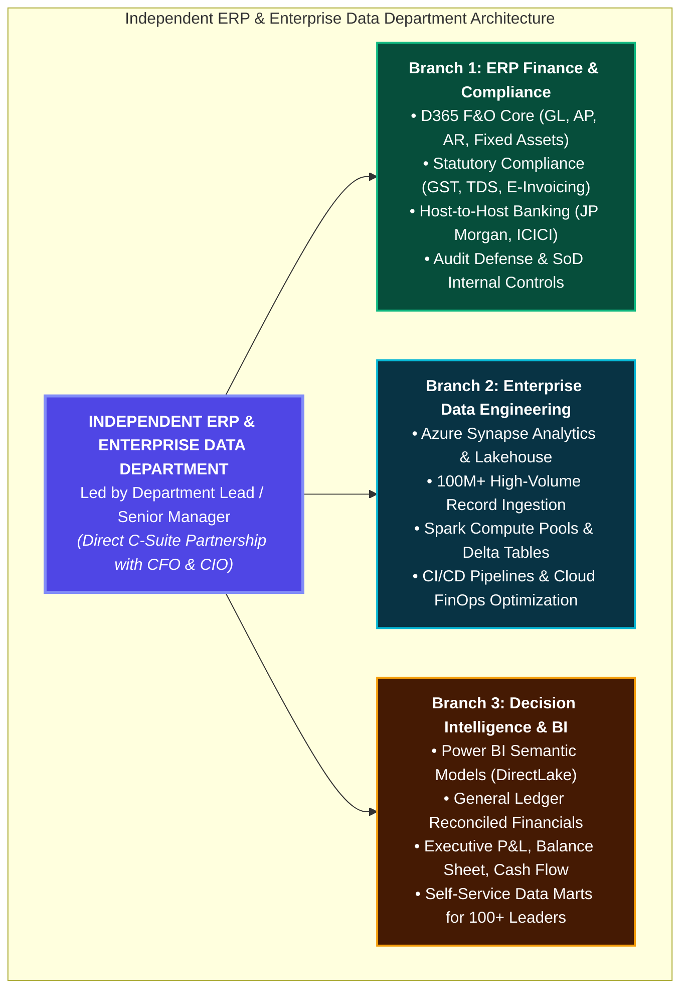
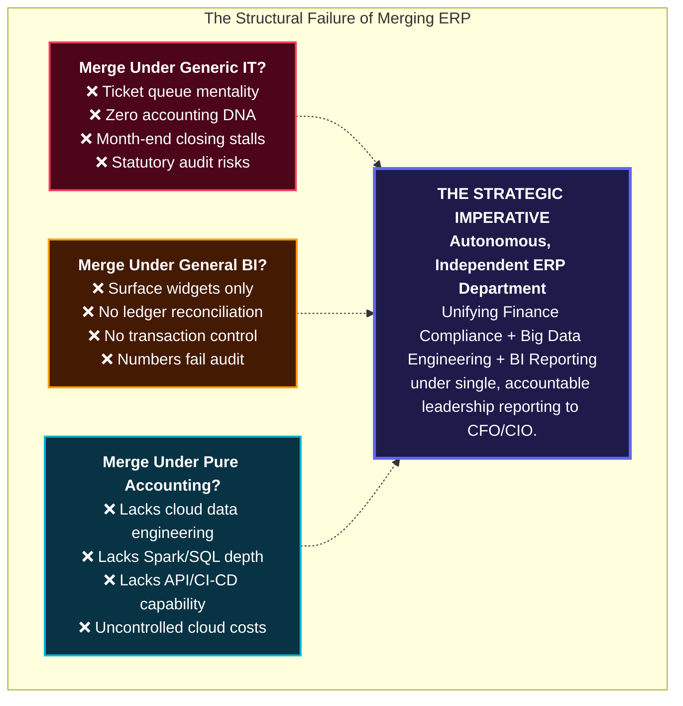
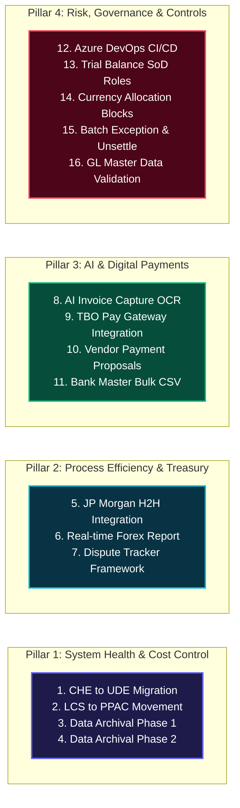
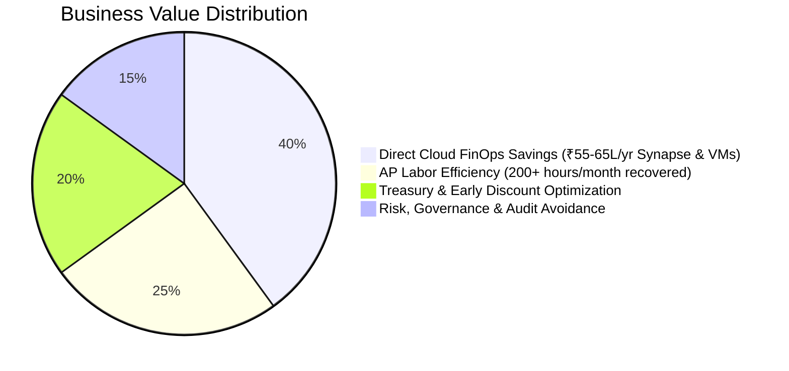
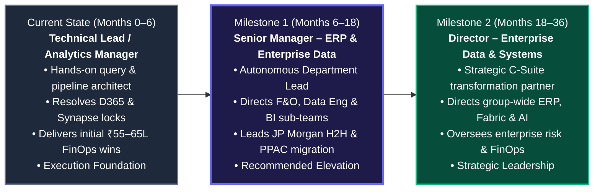

# ENTERPRISE ERP & ANALYTICS STRATEGIC ROADMAP
## Departmental Architecture, Independent Function Mandate & The 16-Deliverable Strategic Blueprint
**Role / Position:** Technical Lead & Analytics Manager – Autonomous ERP Department Lead  
**Current Incumbent:** Vikram Singh  
**Organization:** TBO TEK LIMITED / TBO.COM  
**Functional Scope:** Microsoft Dynamics 365 F&O • Azure Synapse (100M+ Records) • Enterprise Finance & Compliance • Power BI • Cloud FinOps Architecture  

---

## Executive Overview: The Strategic Imperative & Independent Department Mandate

In modern enterprise corporations, an ERP system (Microsoft Dynamics 365 Finance & Operations) is not merely a software application or generic back-office tool—it is the operational, regulatory, and financial circulatory system of the entire company. Every commercial booking, vendor invoice, airline settlement, banking payment, and statutory tax filing flows through it.

### Core Organizational Principle: ERP Must Stand as an Independent Department & Function
Although centered around Dynamics 365 Finance & Operations (F&O), **ERP covers a massive cross-functional footprint that extends far beyond standard software administration:**
1. **Core Finance Operations & Statutory Compliance:** Governing general ledgers, sub-ledgers, statutory tax (GST, TDS, E-Invoicing), banking host-to-host rails, audit trails, and financial balance.
2. **Enterprise Data Engineering:** Managing high-scale cloud big-data platforms (Azure Synapse Analytics, ADLS Gen2, Apache Spark pools, Delta Lake) processing **over 100 Million+ records**, with custom ETL/ELT pipelines, API webhooks, and cloud FinOps cost governance.
3. **Advanced Analytics & Executive BI Reporting:** DirectLake and Power BI semantic models delivering board-level P&L, balance sheets, cashflow forecasting, and automated self-service analytics to 100+ business leaders.

Because this scope spans both deep financial accounting and massive big-data cloud engineering, **ERP must be recognized and governed as an Autonomous, Independent Department and Function**. It must **NOT be merged into generic IT, general BI, or accounting operations**, which leads to conflicting priorities, diluted compliance, and severe operational vulnerabilities.

---

## Part 1: Why ERP Must NOT Be Merged With Other Departments

Attempting to merge ERP under other existing departments is a proven structural failure mode across global enterprises. Here is why ERP demands autonomous departmental status:

### The Three Organizational Incompatibilities:

1. **Why Merging with Generic IT / Infrastructure Fails:**
   - **Ticket-Queue Mentality:** Generic IT treats ERP like email licenses, laptop provisioning, or generic support tickets.
   - **Lack of Accounting DNA:** IT engineers do not understand double-entry bookkeeping, posting profiles, realized vs. unrealized forex gain/loss, sub-ledger to general-ledger reconciliation, or GST/TDS statutory tax laws.
   - **Regulatory Risk:** When an urgent financial closing or statutory e-invoicing bug arises, it gets queued behind routine IT tickets, resulting in delayed financial statements, vendor friction, and statutory tax penalties.

2. **Why Merging with General BI / Analytics Fails:**
   - **Cosmetic Focus Without Accounting Integrity:** General BI teams excel at designing visual charts, executive dashboards, and marketing conversion funnels. However, they lack understanding of accounting controls, transactional locking, and ledger auditability.
   - **Unreconciled Metrics:** BI teams ingest staging tables without reconciling with posting profiles. The result is a glossy dashboard displaying numbers that contradict the General Ledger and immediately fail internal and statutory audits.
   - **No Transactional Ownership:** BI is purely a consumer of data; they cannot fix the operational transaction logic or workflows inside D365 F&O that create the data.

3. **Why Sub-Merging Under Accounting Operations Fails:**
   - **Lacks Deep Cloud Engineering & FinOps Depth:** Pure accounting teams know how to record debit and credit entries, but they lack the technical capability to manage Azure Synapse Spark pools, ADLS delta tables, REST API webhooks, CI/CD automated deployments, and cloud FinOps cost governance.
   - **Unmanaged Infrastructure:** Treating ERP as an accounting end-user software leaves multi-million rupee cloud infrastructure, data pipelines, and architectural migrations (like LCS to PPAC or CHE to UDE) unmanaged.

### The Strategic Value Proposition: The Autonomous ERP Department
Operating ERP as an independent department bridges the critical gap:
- Combines **Commerce & Accounting Expertise (B.Com / FP&A)** with **14+ Years of Enterprise Data Architecture (Synapse, SQL, PySpark, D365 F&O)**.
- Validates accounting rules, enforces statutory compliance, architects cloud big-data pipelines, directs developers, and delivers audited single-source-of-truth intelligence directly to C-suite leadership.

---

## Part 2: The 3 Core Domains of the Independent ERP Department Scope

The scope of this independent department is vast, covering three core enterprise domains:

### Domain 1: Core Finance Operations & Statutory Compliance (D365 F&O Backbone)
- **General Ledger & Subledgers:** Full configuration and maintenance of GL, AP, AR, Fixed Assets, Cash & Bank, and Multi-currency revaluations.
- **Statutory & Tax Compliance:** GST, TDS, E-Invoicing, RBI banking norms, and statutory audit compliance defense.
- **Treasury & Global Banking:** Host-to-Host (H2H) direct integrations (JP Morgan / ICICI), automated payment proposals, and real-time forex exposure tracking.
- **Internal Controls & Audit Safeguards:** Enforcing strict Segregation of Duties (SoD) on Trial Balance reporting, currency settlement restrictions, and automated GL integrity validation scripts.

### Domain 2: Enterprise Data Engineering & Cloud Architecture
- **Azure Synapse Analytics & Lakehouse:** ADLS Gen2, Apache Spark pools, Delta Lake tables, and partition management.
- **100M+ Records Processed:** High-throughput batch and streaming ETL/ELT orchestration handling massive transaction volumes with zero data loss.
- **Integration Middleware:** REST API webhooks (Razorpay/Cashfree), DMF staging architecture, and Azure DevOps CI/CD automated release pipelines.
- **Cloud FinOps & Infrastructure Governance:** Active compute optimization delivering **₹55–65 Lacs in annual recurring cloud savings** across Synapse Spark tuning and idle VM decommissioning.

### Domain 3: Decision Intelligence & Executive BI Reporting
- **Power BI Semantic Models:** DirectLake and Import models aligned directly with ERP posting profiles for 100% financial integrity.
- **Automated Financial Statements:** Automated P&L, balance sheets, cashflow forecasting, and working capital analytics.
- **Executive Self-Service Data Marts:** Curated analytical marts serving 100+ business leaders across the company.
- **Automated Cross-Reconciliation:** Systemic checks between ERP ledgers, bank statements, and BI executive dashboards.

---

## Part 3: The 16-Deliverable Enterprise Roadmap Matrix

The 16 high-impact initiatives identified in the enterprise ERP task inventory have been organized into 4 strategic pillars:

### Complete 16-Deliverable Master Specification

| # | Pillar | Deliverable / Scope | Duration | Effort | Business Impact | Cost Saving & Enterprise ROI Delivery | Executive Business Context |
| :---: | :--- | :--- | :---: | :---: | :--- | :--- | :--- |
| **01** | System Health | **Replacing CHE with UDE** | 4–6 Wks | **High** | Modernizes developer experience with VS 2022; moves development to local laptops. | **High:** Eliminates 100% of monthly Azure VM compute costs across developer fleet. | Equipping developers to code locally on laptops instead of renting expensive cloud servers hourly. |
| **02** | System Health | **Power Platform Movement (LCS to PPAC)** | 8–12 Wks | **High** | Mandatory architectural shift merging F&O into the unified Dataverse ecosystem. | **High:** Consolidates admin overhead and avoids legacy LCS support deprecation costs. | Moving ERP administration from Microsoft's retiring LCS website to modern PPAC portal. |
| **03** | System Health | **Data Archival (Phase 1 – Standard)** | 4–6 Wks | **Med–High** | Shrinks database footprint by archiving core historical accounting transactions. | **High:** Halts massive Dataverse storage overage penalty charges ($30–$40/GB/month). | Moving old financial logs to cold storage so live ERP queries remain fast and cheap. |
| **04** | System Health | **Data Archival (Phase 2 – Custom)** | 8–12 Wks | **High** | Archives bespoke custom tables and cleans bloated DMF staging execution data. | **High:** Deepens storage cost avoidance; maximizes query performance and speeds upgrades. | Writing custom rules to purge temporary batch staging data and custom transaction logs. |
| **05** | Process Efficiency | **Host-to-Host Bank Integration (JP Morgan)** | 10–14 Wks | **High** | Straight-through processing (STP) for global payments & automated e-statement reconciliation. | **High:** Reduces bank fees, removes manual uploads, and saves hundreds of AP hours. | Direct server-to-server connection with JP Morgan so payments and statements flow automatically. |
| **06** | Process Efficiency | **Forex Report Implementation** | 4–6 Wks | **Med–High** | Real-time visibility into currency exposure, accounting vs. transaction currencies, gains/losses. | **Medium:** Eliminates multi-day Excel reconciliations, protects trading margins. | Automated report calculating exactly what the business makes or loses from global exchange rate swings. |
| **07** | Process Efficiency | **Dispute Tracker & Framework Automation** | 6–8 Wks | **Medium** | Accelerates resolution of vendor & customer billing discrepancies via smart routing. | **Medium:** Prevents delayed receivables and avoids late-payment vendor penalties. | Internal ticketing workflow routing disputed invoices to responsible managers automatically. |
| **08** | New Dev / Auto | **Invoice Capture (SG&A Invoices via AI)** | 12–16 Wks | **High** | Touchless AP entry using Microsoft AI Builder & OCR to ingest and match supplier PDFs. | **High:** Direct AP FTE headcount efficiency; ends paper entry bottlenecks. | AI reads supplier PDF invoices and enters data directly into ERP without human typing. |
| **09** | New Dev / Auto | **TBO Pay Related Development** | 10–14 Wks | **High** | Seamless API checkout integrations for fast booking and instant GL settlement. | **High:** Reduces checkout friction and prevents revenue leakage across payment rails. | Wiring digital payment processors into ERP so checkouts are instant, secure, and auto-recorded. |
| **10** | New Dev / Auto | **Vendor Payment Proposal Automation** | 6–8 Wks | **Medium** | Automated payment run algorithms triggered by due dates and cash positions. | **Medium:** Captures 100% of vendor early-payment discounts and cuts AP cycle time. | ERP automatically drafts weekly payment batches based on cash rules instead of manual hunting. |
| **11** | New Dev / Auto | **Bank Master CSV Implementation** | 3–4 Wks | **Low–Med** | Standardizes agency, supplier, and airline bank details onboarding via bulk CSV. | **Medium:** Drastically cuts Master Data MDM overhead; prevents misdirected funds. | Secure template to upload thousands of verified vendor bank accounts in seconds, stopping typos. |
| **12** | Risk & Control | **Pipeline Creation (CI/CD)** | 4–6 Wks | **High** | Automates testing, approval gates, and zero-downtime releases via Azure DevOps. | **High:** Prevents production downtime, crashes, and costly rollback interventions. | Automated digital assembly line testing and deploying software safely without human mistakes. |
| **13** | Risk & Control | **Roles Validation (Trial Balance)** | 3–4 Wks | **Low–Med** | Enforces View-Only reporting security and strict SoD across financial ledgers. | **Medium:** Mitigates financial fraud risks; ensures strict statutory and SOX compliance. | Locking vault doors: ensuring staff who view reports cannot accidentally or maliciously edit figures. |
| **14** | Risk & Control | **Currency Allocation Restrictions** | 4–6 Wks | **Medium** | System blocks preventing settlement of mismatched currencies without FX rates. | **Low–Med:** Eliminates developer emergency data-fixes and complex audit restatements. | Guardrails stopping staff from mistakenly settling EUR invoices with USD without FX calculations. |
| **15** | Risk & Control | **Allocation Reversal & Exception Handling** | 8–10 Wks | **Med–High** | Automates payment un-settlement logic; isolates error rows in bulk processing. | **Medium:** Prevents entire batch crashes; cuts developer support tickets by 80%. | An "undo" button for wrong payments, plus safety nets so one bad payment doesn't crash a 10,000-item run. |
| **16** | Risk & Control | **Activity & GL Master Data Validation** | 2–3 Wks | **Low** | Automated audit scripts verifying GL accounts and vendor records integrity. | **Medium:** Avoids audit penalties and ensures downstream reporting numbers match 100%. | Automated watchdogs verifying that chart of accounts and vendor lists follow company rules. |

---

## Part 4: Quantified Business Value & Cost Savings

The business case for this roadmap delivers measurable enterprise ROI across four critical categories:

### 1. Direct Cloud Infrastructure & FinOps Cost Elimination (Proven Track Record: ₹55–65 Lacs / Year)
- **Azure Synapse Workload & Spark Compute Optimization (Realized & In-Progress):**
  - *Baseline 12-Month Spend:* Incurred **₹9.1M (₹91 Lacs)** cumulatively over the past 12 months, with an average run rate of **₹7.05 Lacs / month**.
  - *Phase 1 Tuning (Realized):* Aligned Spark compute capacity to workload demand (~₹10K daily savings), reducing September billing to ~₹6.0 Lacs, and stabilizing October run-rate to **₹4.5 – ₹5.0 Lacs / month** (saving ₹2.0 – ₹2.5 Lacs / month).
  - *Phase 2 In-Progress Tuning (Active Work):* Unlocking an additional **₹1.0 – ₹1.5 Lacs / month savings**, driving the final stabilized Synapse monthly run-rate down to **₹3.0 – ₹3.5 Lacs / month**!
  - *Final Annual Synapse Savings:* Baseline ₹7.05L/mo (₹85L–₹91L/yr) reduced to ₹3.0–₹3.5L/mo (₹36L–₹42L/yr), yielding **₹45.0 Lacs to ₹55.0 Lacs in net annual recurring savings** (>50% cost cut!).
- **Additional Decommissioning of Continuous Running VMs (Proven Realized Savings):**
  - Proactively audited the Azure environment, identified continuously running unutilized/idle virtual machines, and decommissioned them.
  - *Additional Annual Cost Saved:* **Approx. ₹10.0 Lacs / year** in direct recurring compute charges.
- **Combined Annual Cloud FinOps Savings:**
  - **₹45–55 Lacs/yr (Synapse) + ₹10 Lacs/yr (Idle VMs) = ₹55.0 Lacs to ₹65.0 Lacs / Year (~₹0.55 – ₹0.65 Crore annually)** in verified, recurring bottom-line EBITDA contribution!
  - *Operational Health:* Achieved with **zero reported impact** on ERP operational areas or business-critical workloads.
- **Dataverse Storage Archival (Upcoming Wave 1 & 2):**
  - Eliminates storage overages billed at **$30 to $40 per GB per month**. Archiving 100+ GB yields an additional **$36,000 to $48,000+ (₹30–40 Lacs) in annual recurring savings**.
- **CHE to UDE Migration (Upcoming Wave 1):**
  - Stops hourly Azure VM compute billing for all active developers, eliminating 100% of rented cloud VM charges.

### 2. Operational AP Labor Reallocation
- AI Builder OCR + Automated Payment Proposals + JP Morgan H2H automate **200+ hours per month** of manual clerical work across Accounts Payable and Treasury.

### 3. Working Capital & Treasury Optimization
- Automated payment proposal engine ensures **100% capture of supplier early-settlement discounts** (typically 1–2% of invoiced volume).
- Direct Host-to-Host connectivity reduces transaction transmission fees compared to portal-based retail processing.

### 4. Audit and Downtime De-Risking
- Segregation of Duties on Trial Balance eliminates statutory audit findings.
- Azure DevOps CI/CD deployment pipelines prevent unplanned outages and business interruptions.

---

## Part 5: Position Evolution & Departmental Progression Plan

### Strategic Rationale for Establishing the Independent ERP Department
1. **Full-Stack Accountability:** This position does not manage isolated dashboards; it directs the complete financial data circulatory system across **D365 F&O, Azure Synapse, Banking H2H, and Payment Gateways**.
2. **Direct P&L Impact:** The deliverables led by this role recover hard dollars in cloud compute, storage avoidance, and labor hours (evidenced by ₹55–65 Lacs/year recurring savings).
3. **Institutionalizing Capability Over Dependency:** A mature department does not maintain key-person bottlenecks. This roadmap establishes:
   - **Centralized Standard Operating Procedures (SOPs)** for staging pipelines and Synapse tables.
   - **Automated Self-Healing Audits** that alert teams before issues reach users.
   - **Delegation & Mentorship** that upskills junior analysts and engineers, systematically transitioning the organization from individual dependency to institutional capability.

---

## Part 6: Slide-by-Slide Executive Presentation Guide

Use this section to present directly to executive leadership (CFO, VP Technology, Board):

### Slide 1: Enterprise ERP & Analytics Strategic Roadmap
- **Headline:** Establishing ERP as an Independent Department & Autonomous Function.
- **Talking Point:** "ERP is our enterprise operational nervous system. Centered around D365 F&O and spanning Finance Compliance, 100M+ Synapse Data Engineering, and Executive BI, it must be governed as an autonomous, independent department—never merged or diluted across generic IT or BI."

### Slide 2: Why ERP Must NOT Be Merged: The Independent Department Mandate
- **Headline:** The Multi-Million Rupee Risk of Merging ERP into Other Departments.
- **Talking Point:** "Attempting to merge ERP into Generic IT stalls financial closings in ticket queues; merging it into BI produces cosmetic dashboards without ledger reconciliation; merging it into pure accounting leaves cloud engineering and FinOps unmanaged. ERP must operate as an autonomous department reporting directly to the CFO and CIO."

### Slide 3: The 3 Core Domains of the Independent ERP Department
- **Headline:** Full-Stack Enterprise Scope Under Unified Leadership.
- **Talking Point:** "The ERP department governs three expansive enterprise domains: Core Finance Operations & Statutory Compliance (GL, AP, AR, Tax, Bank H2H), Enterprise Big Data Engineering (Synapse, 100M+ records, Spark, CI/CD), and Executive BI Reporting (DirectLake semantic models and reconciled P&L cockpits)."

### Slide 4: The 4 Strategic ERP Roadmap Pillars
- **Headline:** Operating Charter of the Independent ERP Department.
- **Talking Point:** "We have structured our operational initiatives into 4 clear pillars: System Health & Cost Control, Process Efficiency & Treasury, AI Innovation & Payments, and Risk, Governance & Controls."

### Slide 5: Pillar 1 – System Health & Cloud Cost Optimization
- **Headline:** Direct Cloud Bill Containment.
- **Talking Point:** "By replacing CHE with local UDE development and executing 2-phase data archival, we eliminate developer VM compute billing and prevent $30–$40/GB Dataverse storage penalties."

### Slide 6: Pillar 2 – Process Efficiency & Treasury Automation
- **Headline:** Straight-Through Banking & Real-Time Currency Visibility.
- **Talking Point:** "Host-to-host bank integration with JP Morgan transforms vendor payments into automated, straight-through flows, while our Forex engine protects margins from global currency swings."

### Slide 7: Pillar 3 – AI Innovation & Digital Payments
- **Headline:** Touchless Accounts Payable & Frictionless Gateways.
- **Talking Point:** "Deploying Microsoft AI Builder OCR eliminates manual PDF typing in AP, while TBO Pay API integration guarantees instant customer checkout and automatic GL posting."

### Slide 8: Pillar 4 – Risk, Governance & Financial Controls
- **Headline:** Audit Proofing & Deployment Safety Nets.
- **Talking Point:** "Azure DevOps CI/CD pipelines eliminate deployment downtime, Segregation of Duties protects the Trial Balance, and currency allocation restrictions prevent subledger corruption."

### Slide 9: Master Deliverables & Technical Scope Matrix
- **Headline:** Complete Visibility Into All 16 Deliverables.
- **Talking Point:** "Here is the comprehensive inventory detailing effort, duration, business impact, and ROI for every single project."

### Slide 10: Multi-Wave Roadmap & Phased Gantt
- **Headline:** Disciplined Phased Rollout.
- **Talking Point:** "Wave 1 captures immediate quick wins and cost reductions. Wave 2 establishes core architecture and currency controls. Wave 3 scales AI, banking STP, and payment gateways."

### Slide 11: Quantified Enterprise Value & FinOps Scorecard
- **Headline:** Demonstrating Hard-Dollar Business Value & Proven Cloud Savings.
- **Talking Point:** "This department is already delivering proven financial returns: we have driven Azure Synapse costs down from ₹7.05 Lacs/month to a target ₹3.0–3.5 Lacs/month (saving ₹45–55 Lacs/year), and halted idle continuously running VMs to save another ₹10 Lacs/year—totaling ₹55–65 Lacs in annual recurring cloud savings with zero operational disruption. Furthermore, our upcoming roadmap recovers 200+ AP hours monthly and avoids Dataverse storage overages."

### Slide 12: Department Architecture & Leadership Trajectory
- **Headline:** Structuring the Autonomous Department from Senior Manager to Director.
- **Talking Point:** "Formalizing the department under a Senior Manager structure aligns with the multi-million rupee enterprise scope, cross-functional compliance gravity, and direct cloud FinOps savings—establishing clear sub-teams across F&O, Data Engineering, and BI."

### Slide 13: Institutionalizing Capability: Building Systems, Not Bottlenecks
- **Headline:** Institutional Capability Over Operational Dependency.
- **Talking Point:** "True leadership is about building automated guardrails, documented SOPs, and cross-trained team members so that the business operates reliably and scalably."

### Slide 14: Summary & Implementation Next Steps (With Crowning FinOps Proof Point)
- **Headline:** Clear Next Steps Backed by Proven Financial Leadership.
- **Talking Point:** "As our crowning proof point, we have already engineered ₹55 to ₹65 Lacs in recurring annual cloud savings across Synapse and VM decommissioning with zero business disruption. Step 1 is formally establishing ERP as an Independent Department and Autonomous Function; Step 2 is executing Wave 1 deliverables; Step 3 is formalizing leadership elevation to Senior Manager – ERP & Enterprise Data."

---

## Part 7: Presentation Files & Download Access

1. **Executive PDF Slide Deck (Pre-Generated 14-Page Executive Document):**  
   👉 [ERP_Strategic_Roadmap_Presentation.pdf](file:///c:/Users/Vikram.singh/Downloads/New%20folder%20%285%29/ERP_Strategic_Roadmap_Presentation.pdf)  
   - Exactly 14 slides formatted 1-to-1 on 14 A4 landscape pages.
   - Vector-crisp typography, high-contrast dark theme, and formatted financial scorecards.
   - Ready to attach to leadership emails or present directly.

2. **Interactive Presentation Application (HTML Deck):**  
   👉 [ERP_Roadmap_Presentation.html](file:///c:/Users/Vikram.singh/Downloads/New%20folder%20%285%29/ERP_Roadmap_Presentation.html)  
   - **Direct PDF Download Button:** Click "Download PDF" in the header or on Slide 14 to instantly save the 14-page PDF document.
   - **Print / Save as PDF Button:** Native print engine with automated `@media print` formatting for local or network printers.
   - **Slide Switcher Dropdown & 14 Quick-Jump Chips:** Jump to any slide with one click.
   - **Screen-Edge Floating Switchers:** Click `‹` and `›` on the screen margins to navigate smoothly.
   - **Rich Hover Intel:** Hovering over any deliverable card reveals Key Stakeholders, Tech Enablers, and Key KPIs.
   - **Interactive Deep-Dive Modals:** Click any task card for detailed technical architecture and risk mitigation plans.
